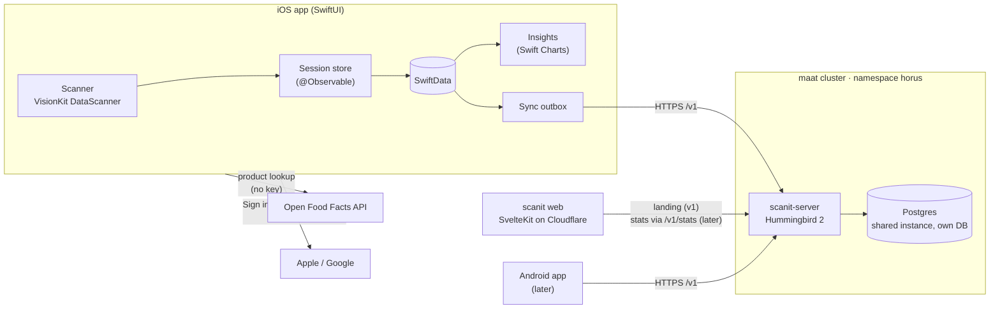

# ScanIt architecture

> **Naming.** Product name **ScanIt** (display) and slug `scanit` (bundle ID, k8s release, secrets, repo),
> chosen 2026-10-09, with App Store availability still to be checked (FND-001). `maat` is only this folder's name. It is also the
> cluster's name (`~/.kube/maat.yaml`, `platform/infra/docs/tailnet.md`), so it never appears in product,
> release or secret names. Domain not chosen: `{{domain}}` remains a placeholder (`rg '\{\{domain\}\}'`).

## Goals

1. In the shop, scan a product and its shelf price in a couple of seconds, and see the running total.
2. Each shopping trip is a **session**. A session may have a **limit**. The total is always shown
   against the limit (or on its own when there is no limit).
3. Remember the price of each barcode **per store**, so the next scan of the same product fills the
   price in.
4. After the trip, give the user numbers and insights about what they spend.
5. iOS first. Android follows on the same API and data model (`docs/android.md`).

Non-goals for v1: receipt scanning (Norviq already does it), crowd-sourced prices shared between
users, price comparison across shops the user has not visited, budgets that span months, any LLM.

## Principles

- **Local-first.** The app is complete offline and signed-out. An account only adds backup, sync
  between devices and, later, the web stats page. This is also App Store guideline 5.1.1 (do not force
  an account for features that do not need one), and it removes friction for the first testers.
- **The device is the source of truth for its own writes.** The server stores and merges; it never
  invents rows.
- **Money is integers.** Every amount is stored as minor units (`Int`, cents) plus an ISO 4217
  currency code. `Decimal` only at the UI edge. Never `Double`.
- **The scan never waits on the network.** Open Food Facts lookups and sync happen after the item is
  in the cart.
- **One contract.** iOS, Android and web all use `docs/api.md`. The server is spec-first
  (`openapi.yaml`), as in aaru.

## System context



## Components

| Component | Tech | Repo / path | Phase |
| --- | --- | --- | --- |
| iOS app | Swift 6, SwiftUI, iOS 18+, iPhone only, SwiftData, VisionKit, Swift Charts | `apps/maat/scanit` | P1 |
| Shared models | SPM package, `Codable` DTOs + validation, used by iOS and server | `apps/maat/scanit-core` | P0 |
| API | Swift, Hummingbird 2, swift-openapi-generator, Fluent, Postgres | `apps/maat/scanit-server` | P4 |
| Landing | SvelteKit 5 on Cloudflare (wrangler) | `apps/maat/scanit-web` | P5 |
| Web stats | Same SvelteKit app, signed-in routes over `/v1/stats` | `apps/maat/scanit-web` | P9 |
| Android | Kotlin, Jetpack Compose, CameraX + ML Kit, Room | `apps/maat/scanit-android` | P8 |
| Infra | Argo CD app + chart values + sealed secrets | `~/Work/production/platform/infra` **only** | P4 |

Never create an app-local `*-infra/` folder. Only `platform/infra` deploys.

## iOS app

### Modules (folders inside one target, split later only if it hurts)

```
scanit/scanit/
  App/            entry point, root tabs, DI
  Features/
    Trip/         start sheet, active trip, cart list, finish summary
    Scanner/      DataScanner wrapper, price parser, barcode normaliser
    History/      past trips, trip detail
    Insights/     charts and numbers
    Account/      sign-in, sync status, delete account, export
  Domain/         SwiftData models, SessionStore, PriceMemory, InsightsCalculator
  Services/       Analytics, OpenFoodFactsClient, APIClient, SyncEngine, AuthService, KeychainService
```

Plain `.xcodeproj` with SPM dependencies, as in every other app in `production` (no XcodeGen or Tuist).
Folders are file-system-synchronised groups, so a new file in a folder joins the target without touching
the project file. `scanit-core` is a local package reference (`../scanit-core`).

**Deployment target iOS 18.0.** Every device that runs iOS 18 has an A12 or later, which is exactly
what DataScanner needs, and iOS 18's SwiftData fixes bugs that iOS 17 shipped with.
Swift 6 language mode, `MainActor` default isolation (Xcode 26 template default).

### Scanner

- `DataScannerViewController` with
  `recognizedDataTypes: [.barcode(symbologies: [.ean13, .ean8, .upce, .code128, .qr]), .text()]`,
  `qualityLevel: .balanced`, `isHighlightingEnabled: true`, `recognizesMultipleItems: true`.
  Check `DataScannerViewController.isSupported` (A12 or later) and `isAvailable` (camera permission)
  before showing it. Start from `apps/norviq/norviq-ios/financeplan/financeplan/Features/Receipts/ReceiptScannerView.swift`,
  which already wraps the scanner and does both checks, but reads QR only.
- **Shelf price (decided 2026-11-05):** one still from `capturePhoto()` on the running scanner, read by
  `ScanItCore.LabelReader` and the parser below, rather than live `.text()` items. The bench then measures what ships,
  and the barcode's box in the same still settles labels side by side. Vision's accurate recogniser does not run on the
  simulator, so accuracy can only be measured on a device or with `tools/label-bench` on a Mac.
- **Fallback** when the scanner is not supported: `AVCaptureMetadataOutput` for barcodes only, plus
  the manual price keypad.
- **Barcode normaliser** (pure function, unit-tested):
  - EAN-13, EAN-8, UPC-E and UPC-A all become a 14-digit GTIN key, so the same product matches whatever symbology was scanned.
  - QR codes in **GS1 Digital Link** form (`https://…/01/{gtin}/…`) give up their GTIN. Any other QR is kept as an opaque code.
  - **In-store EANs with prefix 20–29** (weighed produce, deli) can carry the price or weight inside the code. Each country uses its own layout, so these are parsed only behind a per-country table (P3), and otherwise treated as "ask the price every time".
- **Price parser** (pure function, unit-tested with real shelf-label strings):
  - Candidates come from recognised text items that match a locale-aware money pattern: `1,99`, `1.99`, `€ 1,99`, `1,99 €`, `$1.99`, `2 x 0,99`, `3 for 5.00`.
  - Each candidate is ranked:
    1. Prefer the **largest glyph height**, because the shelf price is the biggest number on the label.
    2. Then prefer text **near and below the locked barcode** (same still, `LabelBox` space), which settles labels side by side. A currency symbol only breaks ties.
    3. Discard tokens next to `/kg`, `/l`, `per 100 g` and the like (unit price).
    4. **Multi-buys** (`2 x 0,99`, `3 for 5.00`) are flagged and never picked: what one item costs would be a guess. A multi-buy printed bigger than the item price drops confidence below the threshold.
    5. **Superscript cents:** a big `2` with a small, top-aligned `49` to its right is merged into `2,49` before parsing.
    6. Keep a second candidate when the label shows a loyalty-card price.
  - The output is the best candidate plus a confidence. Confidence compares the best with the next *different* amount, so the same price printed twice is not a rival. `prefill` is the best candidate only when confidence ≥ `PriceParser.prefillThreshold` (0.6, tuned on the bench); below it nothing is filled in and the candidates are offered as chips. Since ADD-001 (2026-11-15) the scanner adds the item itself when the label gives a prefill and no rival item price, and shows a banner with Undo and Edit; anything less certain still goes to the confirm sheet.
- **Name clash:** iOS 18 / macOS 15 `Vision` ships its own `RecognizedText`. Any file that imports both Vision and ScanItCore must write `ScanItCore.RecognizedText`.
- **Accuracy harness:** `tools/label-bench` (see its README) measures prefill accuracy on real label photos.
  It reads them with `ScanItCore.LabelReader` (Vision text + barcodes on one still, macOS/iOS only), the code
  the app uses. `--record` saves the recognised text and boxes to `scanit-core/Fixtures/labels.json`, and
  `LabelSetTests` replays it on Linux CI against a hand-raised accuracy floor. Photos stay local.

### Data model (SwiftData)

Every model has `id: UUID`, `createdAt`, `updatedAt`, `deletedAt: Date?` (soft delete, needed for
sync), and `syncState` (`.dirty` / `.synced`).

| Model | Fields (besides the common ones) |
| --- | --- |
| `Store` | `name`, `chain?`, `countryCode`, `currency` |
| `ShoppingSession` | `store?`, `limitMinor: Int?`, `currency`, `startedAt`, `endedAt?`, `status` (`active` / `finished` / `abandoned`) |
| `CartItem` | `session`, `gtin` (or opaque code), `productName?`, `quantity: Int` (or `weightGrams?`), `unitPriceMinor: Int`, `priceSource` (`ocr` / `manual` / `remembered` / `embedded`), `scannedAt` |
| `Product` | `gtin` (unique), `name?`, `brand?`, `imageURL?`, `categories: [String]`, `offFetchedAt?` (OFF cache, not synced as user data) |
| `PriceObservation` | `store`, `gtin`, `priceMinor`, `currency`, `observedAt`, `source` |

Derived, never stored: session total, items count, limit progress, all insights.

**Price memory:** on scan, look up the newest `PriceObservation` for `(store, gtin)`. If one exists, prefill it and mark it `remembered`, showing its age ("seen 12 days ago"). Every confirmed add writes a new observation. Observations are kept, never overwritten, and become the price-history insight.

### Live total and limit

The maths is `LimitStatus` in `ScanItCore`, so Android uses identical thresholds. It works in integers only and provides:

- `totalMinor`
- `remainingMinor?`
- `progress` (0…1+)
- `state`: `.noLimit`, `.ok`, `.near` (≥ 80 %), `.over` (> 100 %)

`LimitState.feedback(from:to:)` decides the haptic: one per upward crossing.

`@Observable final class SessionStore` (`scanit/scanit/Domain/SessionStore.swift`) owns the active trip.
Every cart change goes through it, and it publishes `limitState` plus a `feedback` event that views play with
`.sensoryFeedback`.

**SwiftData and Swift 6.2:** the target uses `MainActor` default isolation. That makes `@Model` key paths
non-`Sendable` inside `#Predicate`, so the model classes, the `SyncedRecord` protocol and `SyncState` are
declared `nonisolated`. Keep that on any new model.
On Xcode 26.4 (CI) a `nonisolated` model no longer satisfies `Identifiable` for `ForEach`, so pass `id: \.id`
explicitly when iterating models. Local Xcode 26.2 does not catch this; CI does.

When `state` changes, the app plays a haptic (`.warning` at near, `.error` at over) and the HUD changes colour. Thresholds are constants for now. Making them a setting is P3, if testers ask for it.

**P7:** a Live Activity and Dynamic Island showing the total, the limit and the remaining amount, so the user sees them with the phone locked. It is updated locally with ActivityKit, so no push server is needed.

### Open Food Facts

`GET https://world.openfoodfacts.org/api/v2/product/{gtin}?fields=product_name,brands,image_front_small_url,categories_tags`
with a descriptive `User-Agent: ScanIt/<version> (<contact email>)`, which OFF requires. Results go
into `Product`. A miss is cached too, as a negative entry with a TTL. The lookup runs after the
item is added and fills in the name and photo when it returns. It never blocks the scan.
Offline, the lookup goes into a pending queue (`Product.offFetchedAt == nil`) and is retried when the
network returns (see Offline below).
Implemented in `Domain/ProductEnricher.swift` and `Services/OpenFoodFacts.swift`. The lookup uses the pack's 13-digit
code (`ScannedCode.displayValue`). Weighed-produce/deli codes (`isInStore`) and opaque codes are never looked up.
UI tests swap in `FixedProductLookup`, so no test touches the network except the opt-in live test.

### Insights

`InsightsCalculator` is a pure type over arrays of value snapshots, so it can be unit-tested
without SwiftData. The catalogue of numbers is in `DESIGN.md`. In P9 the same definitions are
implemented as SQL behind `/v1/stats`. The definitions in `DESIGN.md` are the contract both sides use.

### Auth (P4)

- **Sign in with Apple:** `AuthenticationServices` with a nonce and SHA-256, as in `apps/lumina/LuminaVaultClient/LuminaVaultClient/Services/AppleSignInService.swift`.
- **Google:** GoogleSignIn SPM, as in `…/Services/GoogleSignInService.swift`.
- The ID token goes to `POST /v1/auth/{apple|google}`. The server returns its own access JWT (short) and refresh token (long). Both are kept in the Keychain (`…/Services/KeychainService.swift`).
- Offering Google sign-in requires an equivalent privacy-focused option (App Store guideline 4.8), and Sign in with Apple covers it.
- **Account deletion** inside the app is mandatory (App Store 5.1.1(v), and Google Play's deletion URL). It calls `DELETE /v1/me`.

### Offline (all phases)

Supermarkets often have bad Wi-Fi and weak signal, so offline is the **normal case**, not an error.

- **Everything in a trip works with no network:**
  - start a trip
  - scan barcodes and read shelf prices (VisionKit is on-device)
  - remembered prices (local SwiftData)
  - running total and limit
  - finish
  - history and insights
  - the paywall entitlement check (StoreKit 2 caches it on device)
- **The network is used only for:**
  - Open Food Facts lookups, queued while offline
  - sync, queued in the outbox
  - sign-in, which is the one action that needs the network and says so
- **Connectivity watcher:** `NWPathMonitor` in `ConnectivityMonitor`.
  - When the path becomes `.satisfied`, it triggers `SyncEngine.flush()` and the OFF queue.
  - Sync runs on any connection, Wi-Fi or cellular, because payloads are a few KB. A "Sync on Wi-Fi only" toggle is Deferred.
- **Background catch-up:** a `BGAppRefreshTask` (`scanit.sync`) flushes the outbox if the app was closed before the network came back. iOS decides when it runs. The foreground trigger is the dependable one.
- **Retries:** exponential backoff with jitter (2 s, then doubling, capped at 5 min). Reset on a path change.
- **Pushes are idempotent:** rows carry client UUIDs and LWW `updatedAt`, so re-sending a batch after a timeout is safe.
- **An expired access token offline** never signs the user out. The app keeps working locally and refreshes the token when the network returns. Only a refresh **rejected** by the server ends the session, and even then local data stays.
- **UI:** a small cloud icon in Settings and History shows `synced`, `n changes waiting` or `offline`. There is no banner or alert during a trip.

### Sync (P4)

- When a signed-out user signs in for the first time, all local rows are uploaded under the new account. There is no data loss and no merge prompt.
- **Push:** every write marks the row dirty. `SyncEngine` batches dirty rows to `POST /v1/sync/push` when the app is foregrounded, a session finishes, the network returns (`ConnectivityMonitor`), or the background refresh task runs.
- **Pull:** `GET /v1/sync/pull?cursor=` returns rows changed since the cursor. The cursor is a server-assigned monotonic `server_seq` (Postgres sequence), not a timestamp, so device clock skew cannot drop rows.
- **Conflicts:** last-writer-wins on `updatedAt` per row. Deletes are tombstones. One person editing on two devices is the only realistic conflict, and LWW is enough for it.
- `Product` (the OFF cache) does not sync. Each device refetches it.
- **Account deletion keeps a local copy** (owner decision, 2026-10-09). `DELETE /v1/me` wipes the server.
  On the device, the Keychain session is cleared, all rows go back to `syncState = .dirty`, and `server_seq` is reset.
  The app then carries on as a signed-out, local-only app with all trips intact. Signing in again later
  uploads them to the new account.

### Purchases (P6)

Free app plus one **non-consumable** in-app purchase, "ScanIt Unlimited" (owner decision, 2026-10-09). The unlock covers **unlimited trips** and **the full trip history**.

| | Free | Unlimited |
| --- | --- | --- |
| Scanning, total, limit, price memory | ✓ | ✓ |
| Trips started | **N per calendar month** | unlimited |
| History list | **last M trips** visible | all trips |
| Insights | ✓ (**OPEN**: over all data or visible trips only) | ✓ |

- **Proposed limits:** N = 4 and M = 10. They are **OPEN**; the owner tunes them after P2 data.
- **Hidden trips are kept,** never deleted. Unlocking shows them all again.
- **The paywall never interrupts an active trip.** The trip quota is checked only on **Start trip**. A trip in progress always finishes.
- **StoreKit 2:**
  - `Product.products(for:)`, `purchase()`, `Transaction.currentEntitlements` and `Transaction.updates` listener
  - entitlement checks work offline, from the device cache
  - "Restore purchases" in Settings
  - no receipt server for v1
- **Android:** a Play Billing one-time product with the same limits. Cross-platform unlock sharing (buy on iOS, use on Android) is **Deferred**. It would need server-side entitlement validation.
- **Paywall off until launch:** the paywall sits behind a flag that is off until P6, so P2 testers are never limited.

### Analytics

PostHog and Sentry, initialised as in `apps/lumina/LuminaVaultClient/LuminaVaultClientApp.swift`. Events:

| Event | Properties |
| --- | --- |
| `trip_started` | `has_limit` |
| `item_scanned` | `price_source`, `symbology` |
| `price_ocr_result` | `outcome` (`accepted` / `edited` / `none`), `ms` (barcode lock to Add) |
| `price_ocr_corrected` | (a label price changed later, e.g. in History) |
| `trip_finished` | `items`, `under_limit?` |
| `insights_viewed` | |
| `discord_link_clicked` | `surface` (`settings`: the About sheet) |
| `signed_in` | `provider` |

No amounts or product names are sent. These events are the measurement behind the P2 strangers gate (`BACKLOG.md`).

Until PostHog (FND-004) the shelf-price field metrics are also counted on the phone from each item's
`priceSource` (`ocr`, `ocr_edited`, `ocr_corrected`) by `OCRStats`, shown in a debug-only Insights section.

## Server — `scanit-server` (P4)

Template: `apps/aaru/aaru-server` (Hummingbird 2, routes generated from `openapi.yaml`, Fluent,
migrations gated behind a flag, shared models in a core package).

- **Auth:** copy and adapt from LuminaVault, which already verifies both providers' ID tokens against their JWKS:
  - `apps/lumina/LuminaVaultServer/Sources/App/Auth/OAuth/{OAuthProvider,AppleOAuthProvider,GoogleOAuthProvider}.swift`
  - `…/Auth/JWT/{SessionToken,JWTKeyLoader}.swift`
  - `…/Auth/Middleware/JWTAuthenticator.swift`

  `aud` must match the iOS bundle ID (Apple), and the iOS and Android OAuth client IDs (Google).
- **Tables:**
  - Account: `users`, `auth_identities (provider, provider_subject)` unique together, `refresh_tokens` (hashed, rotating).
  - User data: `stores`, `sessions`, `cart_items`, `price_observations`, each with `user_id`, `updated_at`, `deleted_at`, `server_seq`.
- **Data layer:** one boundary (store protocols with Fluent implementations). No SQL in handlers, same rule as aaru.
- **Deletion:** `DELETE /v1/me` deletes the user and cascades to all their rows. No "soft" account delete.
- **No LLM, no transcription in v1.** If AI insights are ever added, read `platform/infra/docs/llm-haiku-trial.md` first.

## Infra (P4) — in `~/Work/production/platform/infra`

Worked example: Khepri (`argocd/apps/khepri-production.yaml` → chart `charts/norviq-app`,
values in `apps/khepri/*/values-*.yaml`). Read `docs/hosted-projects-namespaces.md` and
`docs/deployment.md` first.

| Piece | What to add |
| --- | --- |
| Argo CD | `argocd/apps/scanit-production.yaml`. Merging to `main` deploys. |
| Values | `apps/scanit/web/values-production.yaml` (image, env, ingress, `migrate:` PreSync hook) |
| Namespace | `horus`, where new apps go. No new namespace. |
| Database | A new database and role on the shared instance `apps/data/postgres.yaml` |
| Ingress | Traefik, cert-manager `letsencrypt-prod`, host `api.{{domain}}`, `gethomepage.dev/*` annotations |
| Secrets | `secrets/scanit/scanit-env.yaml` (JWT signing key, `APPLE_*`, `GOOGLE_CLIENT_*`; Loci's env lists the key names), `scanit-postgres-credentials.yaml`, `ghcr-pull.yaml`, `README.md`. Sealed for namespace **`horus`** and the **exact** secret name. Sealed for the wrong one, a value silently decrypts to nothing. |
| CI | Copy `apps/norviq/norviq-backend/.github/workflows/deploy-k3s.yml`: build, push to `ghcr.io`, `yq` bump of the tag in the infra repo, Argo CD sync. |

The server makes no calls to `whisper` or any other in-cluster service, so `horus.yaml` network policies need nothing.

## Web — `scanit-web`

- **P5 landing:** SvelteKit 5 on Cloudflare, as in `apps/aaru/aaru-client` and `apps/lumina/LuminaVaultWebApp`. It holds:
  - one page with App Store (and later Play) badges
  - `/privacy`, `/terms`
  - `/delete-account`, which explains in-app deletion and gives a contact. Play requires this URL.

  It is static, and makes no API calls.
- **P9 stats:** in the same app, sign-in (Apple and Google web flows against the same API), then
  `/v1/stats/*` charts. The first build is read-only: no editing trips on the web.

## Relation to Norviq

Norviq (an active project) already does receipt scanning and grocery categorisation
(`norviq-backend/Sources/StockPlanBackend/Macro/PersonalInflationCalculator.swift`).
ScanIt stays a separate, small app. A possible later hook is "export finished trips to Norviq" as
grocery spend (**Deferred**, `BACKLOG.md`). No shared database and no merge.
